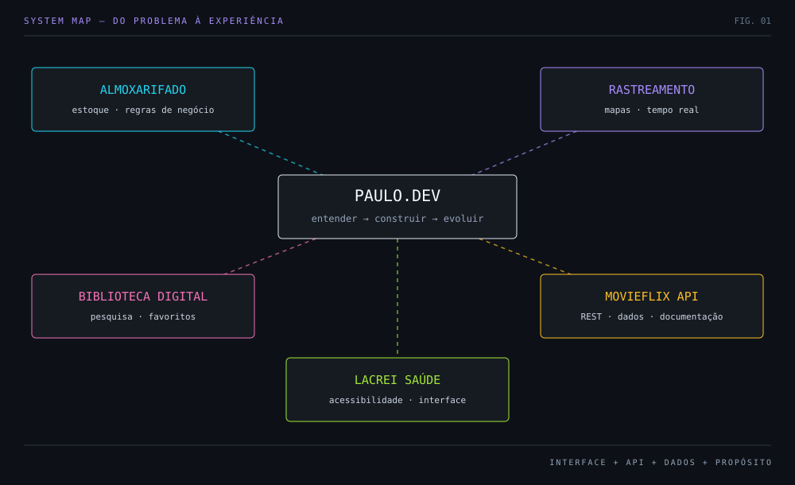
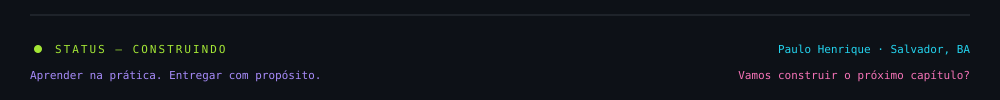

<div align="center">


<br />

<h1>⚔️ PAULO HENRIQUE ⚔️</h1>

### FULL STACK DEVELOPER · GENERATIVE AI · LLMs · AI AGENTS

**Escolha seu personagem. Domine a tecnologia. Resolva problemas reais.**

Desenvolvendo aplicações web e soluções inteligentes que conectam tecnologia, automação e negócio.

<br />

`🔥 PLAYER 1: FULL STACK` &nbsp; `❄️ PLAYER 2: INTELIGÊNCIA ARTIFICIAL` &nbsp; `🏆 FATALITY: PROBLEMAS RESOLVIDOS`

<br />

[🌐 **PORTFÓLIO**](https://paulo-fullstack-dev.vercel.app/) &nbsp; • &nbsp; [🔵 **LINKEDIN**](https://www.linkedin.com/in/paulo-henrique-ferreira-fran%C3%A7a/) &nbsp; • &nbsp; [📩 **E-MAIL**](mailto:paulohenriqueferreirafranca2@gmail.com) &nbsp; • &nbsp; [💻 **REPOSITÓRIOS**](https://github.com/PauloHenrique993940?tab=repositories)

<br />

━━━━━━━━━━━━━━━━━━━━━━━━━━━━━━━━━━━━━━━━━━━━━━━━━━━━━━━━━━━━

### 🔥 FIGHT!

</div>

## 🥋 PLAYER PROFILE

Sou **Paulo Henrique Ferreira França**, Desenvolvedor Full Stack, formado em **Análise e Desenvolvimento de Sistemas**, com experiência na construção de aplicações web e implementação de soluções com **Inteligência Artificial Generativa, LLMs, Prompt Engineering e agentes de IA**.

Minha trajetória começou na **logística e gestão de materiais**, com atuação na Secretaria da Segurança Pública do Estado da Bahia. Essa experiência me deu uma visão prática sobre processos operacionais, controle de estoque, rastreabilidade e eficiência.

Hoje, combino **Engenharia de Software + Inteligência Artificial + Visão de Negócio** para transformar problemas reais em soluções digitais.

> **MEU CÓDIGO DE LUTA:** entender o problema, projetar a solução, escrever código de qualidade e usar IA de forma estratégica para ampliar resultados.

| DADOS DO PLAYER | STATUS |
| :--- | :--- |
| 🥊 **Classe** | Desenvolvimento Full Stack · Aplicações Web |
| 🧠 **Poder especial** | LLMs · Agentes de IA · Prompt Engineering |
| ⚔️ **Especialidades** | React · Next.js · Node.js · TypeScript · PostgreSQL |
| 🏆 **Combinação** | Engenharia de Software + IA + Visão de Negócio |
| 🌎 **Arena** | Salvador, Bahia · Brasil |
| 🎯 **Próximo desafio** | Oportunidades em Desenvolvimento Full Stack e IA |

## 🤖 IA GENERATIVA: SPECIAL MOVES

Além de utilizar Inteligência Artificial como ferramenta de apoio à programação, tenho experiência prática na **implementação de soluções com IA Generativa, modelos de linguagem (LLMs), agentes inteligentes e Prompt Engineering**.

- **LLMs:** aplicação de modelos de linguagem em soluções de software.
- **Agentes de IA:** implementação de agentes e fluxos inteligentes para automação de tarefas.
- **Prompt Engineering:** estruturação e otimização de prompts com contexto, instruções e objetivos definidos.
- **IA Generativa:** recursos inteligentes para ampliar funcionalidades e automatizar processos.
- **AI-Assisted Development:** apoio à implementação, refatoração, debugging, testes e análise de código.
- **Engenharia de Software:** integração de IA com boas práticas, segurança, validação e manutenção.

**Meu foco não é apenas usar IA para gerar código, mas aplicar Inteligência Artificial para desenvolver soluções que entreguem valor real.**

## 🗺️ THE REALM MAP



## 🏆 TOURNAMENT: PROJETOS

### 🔥 01 / Sistema Inteligente de Gestão de Almoxarifado

Aplicação Full Stack desenvolvida a partir da minha experiência em logística e gestão de materiais.

**Golpes especiais:**
- Controle de estoque, inventário e patrimônio.
- Registro de entradas, saídas e movimentações.
- Autenticação e gerenciamento de permissões.
- Organização e rastreabilidade de materiais.
- Relatórios e gerenciamento de informações.

`REACT` · `TYPESCRIPT` · `NODE.JS` · `EXPRESS` · `POSTGRESQL` · `PRISMA` · `SUPABASE`

---

### ❄️ 02 / Rastreamento em Tempo Real

Sistema de acompanhamento logístico com **geolocalização, mapas interativos e comunicação em tempo real**. Permite visualizar veículos, acompanhar movimentações e facilitar a comunicação entre operadores e motoristas.

`REACT` · `WEBSOCKET` · `POSTGRESQL` · `SUPABASE` · `GOOGLE MAPS API`

---

### 🥋 03 / Biblioteca Digital

Aplicação para descoberta e organização de conteúdos digitais, com **pesquisa, filtros, favoritos e biblioteca pessoal**. Foco em componentização, gerenciamento de estado, experiência do usuário e responsividade.

`REACT` · `TYPESCRIPT` · `VITE` · `REACT ROUTER` · `CONTEXT API`

---

### ⚡ 04 / MovieFlix API

API REST para gerenciamento de filmes, desenvolvida com foco em arquitetura de back-end e organização de dados.

**Recursos:** CRUD, filtros, paginação, validação de dados e documentação Swagger.

`NODE.JS` · `EXPRESS` · `TYPESCRIPT` · `PRISMA` · `POSTGRESQL` · `SWAGGER`

---

### 🐉 05 / Lacrei Saúde — Desafio Front-end

Interface desenvolvida com foco em **acessibilidade digital, responsividade, componentização e experiência do usuário**.

`REACT` · `TYPESCRIPT` · `STYLED COMPONENTS` · `VITE`

**[↗ Abrir demonstração](https://lacrei-saude-desafio.vercel.app/)**

## 🛠️ CHARACTER BUILD: EM CONSTRUÇÃO

> **Da análise do problema à entrega:** desenvolvo soluções conectando interfaces modernas, regras de negócio, dados estruturados e Inteligência Artificial.

| 🥊 FRONT-END | ⚔️ BACK-END | 🧠 ENGENHARIA E IA |
| :--- | :--- | :--- |
| Interfaces responsivas | APIs REST | LLMs e agentes de IA |
| Componentização | Autenticação | Prompt Engineering |
| Acessibilidade | Modelagem de dados | Testes e debugging |
| Experiência do usuário | Integrações | Git, deploy e automação |

**[↗ Explorar atividade e contribuições no GitHub](https://github.com/PauloHenrique993940)**

## 🧭 ORIGIN STORY

```text
LOGÍSTICA E MATERIAIS
        │
        ▼
ANÁLISE E DESENVOLVIMENTO DE SISTEMAS
        │
        ▼
DESENVOLVIMENTO FULL STACK
        │
        ▼
INTELIGÊNCIA ARTIFICIAL E AGENTES
        │
        ▼
SOFTWARE + IA + VISÃO DE NEGÓCIO
```

| CAPÍTULO | TRAJETÓRIA |
| :--- | :--- |
| 🥋 **Experiência profissional** | Logística e gestão de materiais — Secretaria da Segurança Pública do Estado da Bahia |
| 🎓 **2024** | Análise e Desenvolvimento de Sistemas — Unifatecie · Concluído |
| 📚 **Em andamento** | Engenharia de Software — Estácio |
| 📚 **Em andamento** | Pós-graduação em Desenvolvimento Front-end — Anhanguera |
| 🤖 **Evolução técnica** | IA Generativa · LLMs · Prompt Engineering · Agentes de IA |
| 🏆 **Objetivo profissional** | Projetos Full Stack, automação e soluções com Inteligência Artificial |

## ⚔️ ARSENAL: STACK

| CATEGORIA | TECNOLOGIAS |
| :--- | :--- |
| 🧩 **Linguagens** | TypeScript · JavaScript · Python · PHP |
| 🥊 **Front-end** | React · Next.js · Angular · HTML · CSS · Tailwind CSS |
| ⚙️ **Back-end** | Node.js · Express · APIs REST · WebSocket |
| 🗃️ **Banco de dados** | PostgreSQL · MySQL · Prisma · Supabase |
| 🤖 **Inteligência Artificial** | LLMs · IA Generativa · AI Agents · Prompt Engineering · AI-Assisted Development |
| 🎨 **UI/UX** | Figma · Styled Components · Responsividade · Acessibilidade |
| 🧰 **Ferramentas** | Git · GitHub · Docker · Vite · Vercel · Postman · Jest · VS Code |

<div align="center">

━━━━━━━━━━━━━━━━━━━━━━━━━━━━━━━━━━━━━━━━━━━━━━━━━━━━━━━━━━━━

### 🏆 ENGENHARIA DE SOFTWARE + IA + VISÃO DE NEGÓCIO

**Aberto a oportunidades em Desenvolvimento Full Stack e soluções com Inteligência Artificial.**

Vamos conversar sobre tecnologia, projetos e oportunidades?

[🌐 **PORTFÓLIO**](https://paulo-fullstack-dev.vercel.app/) &nbsp; • &nbsp; [💼 **LINKEDIN**](https://www.linkedin.com/in/paulo-henrique-ferreira-fran%C3%A7a/) &nbsp; • &nbsp; [📩 **E-MAIL**](mailto:paulohenriqueferreirafranca2@gmail.com)

<br />

`THANKS FOR PLAYING` &nbsp; `FATALITY: BUGS DEFEATED` &nbsp; `CONTINUE?  YES`

<br />



</div>
