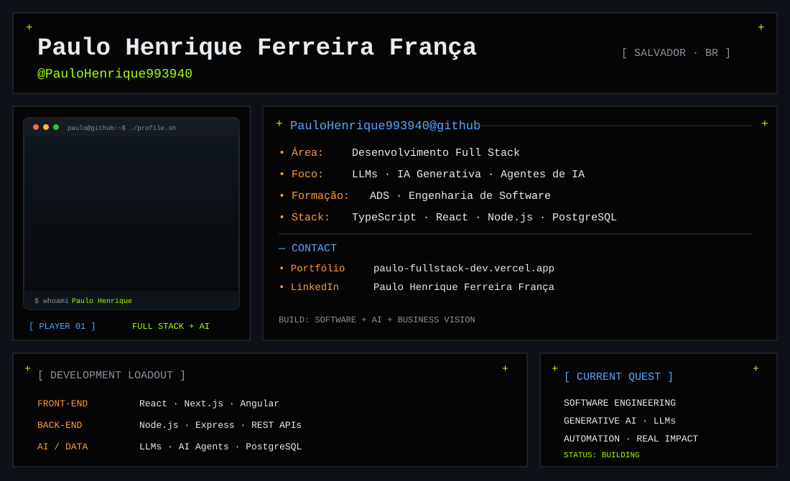



[🌐 Portfólio](https://paulo-fullstack-dev.vercel.app/) · [💼 LinkedIn](https://www.linkedin.com/in/paulo-henrique-ferreira-fran%C3%A7a/) · [📩 E-mail](mailto:paulohenriqueferreirafranca2@gmail.com) · [💻 Repositórios](https://github.com/PauloHenrique993940?tab=repositories)

<table>
<tr>
<td width="58%" valign="top" align="center">

### ` [ GITHUB STATS ] `

</td>
<td width="42%" valign="top" align="center">

### ` [ TOP LANGUAGES ] `

</td>
</tr>
</table>

## `01 / PERFIL`

Sou **Paulo Henrique Ferreira França**, desenvolvedor Full Stack formado em Análise e Desenvolvimento de Sistemas. Desenvolvo aplicações web e soluções inteligentes conectando interfaces, regras de negócio, dados e Inteligência Artificial.

Minha experiência em logística e gestão de materiais na Secretaria da Segurança Pública do Estado da Bahia me deu uma visão prática de processos operacionais, controle de estoque, rastreabilidade e eficiência. Hoje, levo esse conhecimento para a construção de software útil e bem estruturado.

## `02 / PROJETOS`

| Projeto | O que resolve | Stack |
|:--|:--|:--|
| **Gestão de Almoxarifado** | Estoque, inventário, patrimônio e movimentações. | React · TypeScript · Node.js · Express · PostgreSQL · Prisma |
| **Rastreamento em Tempo Real** | Acompanhamento logístico com geolocalização, mapas e comunicação em tempo real. | React · WebSocket · Supabase · Google Maps API |
| **Biblioteca Digital** | Pesquisa, filtros, favoritos e biblioteca pessoal. | React · TypeScript · Vite · React Router |
| **MovieFlix API** | API REST com CRUD, filtros, paginação, validação e Swagger. | Node.js · Express · TypeScript · Prisma · PostgreSQL |
| **Lacrei Saúde** | Interface responsiva com foco em acessibilidade. [Ver demonstração](https://lacrei-saude-desafio.vercel.app/) | React · TypeScript · Styled Components · Vite |

## `03 / STACK`

**Desenvolvimento:** TypeScript · JavaScript · Python · PHP · React · Next.js · Angular · Node.js · Express  
**Dados e ferramentas:** PostgreSQL · MySQL · Prisma · Supabase · Git · Docker · Vite · Vercel  
**Inteligência Artificial:** IA Generativa · LLMs · Agentes de IA · Prompt Engineering

## `04 / FORMAÇÃO`

- Análise e Desenvolvimento de Sistemas — Unifatecie, concluído em 2024.
- Engenharia de Software — Estácio, em andamento.
- Pós-graduação em Desenvolvimento Front-end — Anhanguera, em andamento.

**SOFTWARE ENGINEERING · GENERATIVE AI · BUSINESS VISION**

