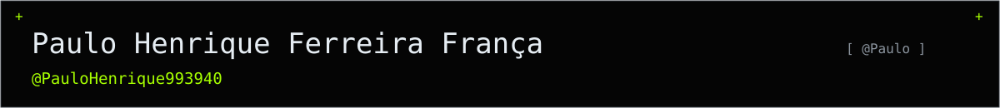



<table>
<tr>
<td width="34%" valign="top" align="center">

`paulo@github:~$ whoami`

**Paulo Henrique Ferreira França**

</td>
<td width="66%" valign="top">

### + PauloHenrique993940 ────────────────────────

- Área: Desenvolvimento Full Stack · Aplicações Web
- Localização: Salvador, Bahia, Brasil
- Formação: Análise e Desenvolvimento de Sistemas — 2024
- Estudos: Engenharia de Software · Pós-graduação em Desenvolvimento Front-end
- Foco: IA Generativa · LLMs · Agentes de IA

#### — Contact ─────────────────────────────────────

- Portfólio: [paulo-fullstack-dev.vercel.app](https://paulo-fullstack-dev.vercel.app/)
- GitHub: [github.com/PauloHenrique993940](https://github.com/PauloHenrique993940)
- LinkedIn: [Paulo Henrique Ferreira França](https://www.linkedin.com/in/paulo-henrique-ferreira-fran%C3%A7a/)
- E-mail: [paulohenriqueferreirafranca2@gmail.com](mailto:paulohenriqueferreirafranca2@gmail.com)

#### — GitHub Stats ───────────────────────────────

</td>
</tr>
</table>

<table>
<tr>
<td width="76%" valign="top">

### ` [ TOP LANGUAGES ] ` ──────────────────────────────────

**Stack:** TypeScript · JavaScript · React · Next.js · Node.js · PostgreSQL · Prisma · Supabase  
**IA:** LLMs · IA Generativa · Agentes de IA · Prompt Engineering

</td>
<td width="24%" align="center" valign="middle">

`PLAYER 1`  
`FULL STACK + AI`

</td>
</tr>
</table>

### `— ABOUT`

Sou desenvolvedor Full Stack, formado em Análise e Desenvolvimento de Sistemas. Construo aplicações web e soluções inteligentes conectando interfaces, regras de negócio, dados e Inteligência Artificial.

Minha experiência em logística e gestão de materiais na Secretaria da Segurança Pública do Estado da Bahia me trouxe uma visão prática de processos operacionais, controle de estoque, rastreabilidade e eficiência. Hoje, aplico essa visão na criação de software útil e bem estruturado.

### `— PROJECTS`

| Projeto | Descrição | Tecnologias |
|:--|:--|:--|
| **Gestão de Almoxarifado** | Controle de estoque, inventário, patrimônio e movimentações. | React · TypeScript · Node.js · PostgreSQL · Prisma |
| **Rastreamento em Tempo Real** | Acompanhamento logístico com geolocalização, mapas e comunicação em tempo real. | React · WebSocket · Supabase · Google Maps API |
| **Biblioteca Digital** | Pesquisa, filtros, favoritos e biblioteca pessoal. | React · TypeScript · Vite · Context API |
| **MovieFlix API** | API REST com CRUD, filtros, paginação e Swagger. | Node.js · Express · TypeScript · PostgreSQL |
| **Lacrei Saúde** | Interface acessível e responsiva. [Abrir demo](https://lacrei-saude-desafio.vercel.app/) | React · TypeScript · Vite |

**ENGENHARIA DE SOFTWARE + IA + VISÃO DE NEGÓCIO**  
[PORTFÓLIO](https://paulo-fullstack-dev.vercel.app/) · [LINKEDIN](https://www.linkedin.com/in/paulo-henrique-ferreira-fran%C3%A7a/) · [E-MAIL](mailto:paulohenriqueferreirafranca2@gmail.com)

