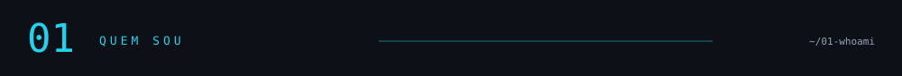
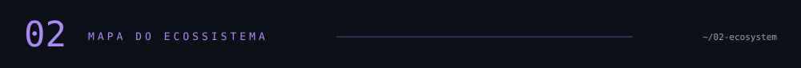
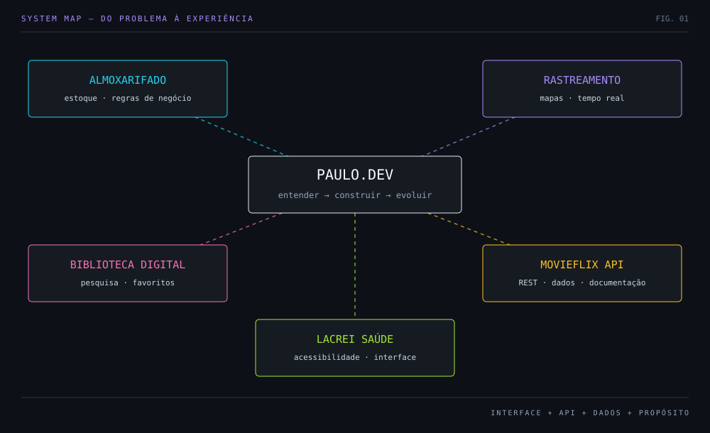
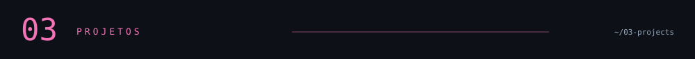
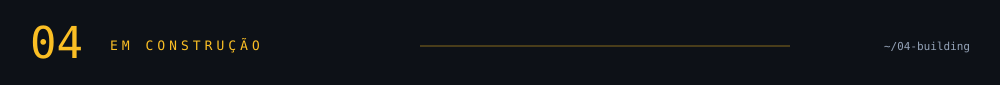
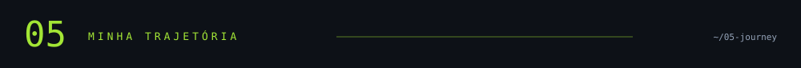
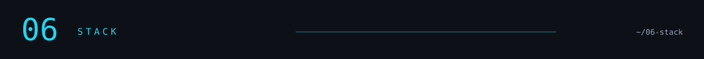
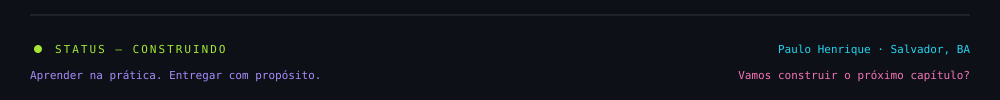

<div align="center">

<a href="https://paulo-fullstack-dev.vercel.app/"><strong>🟣 PORTFÓLIO</strong></a> &nbsp; · &nbsp; <a href="https://www.linkedin.com/in/paulo-henrique-ferreira-fran%C3%A7a/"><strong>🔵 LINKEDIN</strong></a> &nbsp; · &nbsp; <a href="mailto:paulohenriqueferreirafranca2@gmail.com"><strong>🟡 E-MAIL</strong></a> &nbsp; · &nbsp; <a href="https://github.com/PauloHenrique993940?tab=repositories"><strong>🟢 REPOSITÓRIOS</strong></a>

</div>

## 

Sou **Paulo Henrique Ferreira França**, desenvolvedor em formação com foco em **Front-end e Full Stack**. Construo interfaces com React e TypeScript e trabalho na integração com APIs e bancos de dados.

Minha trajetória começou na **logística e gestão de materiais**. Hoje, uso essa experiência para entender processos, identificar problemas operacionais e desenvolver soluções com organização, usabilidade e rastreabilidade.

| `PROFILE` | `DETAILS` |
| :--- | :--- |
| 🟦 **FOCO** | Interfaces responsivas · APIs REST · Acessibilidade |
| 🟪 **OBJETIVO** | Estágio em desenvolvimento Front-end ou Full Stack |
| 🟨 **LOCAL** | Salvador, Bahia · Brasil |
| 🟩 **MENTALIDADE** | Entender o problema. Construir. Aprender. Evoluir. |

## 



## 

### 🟦 01 / Sistema Inteligente de Gestão de Almoxarifado

Controle de materiais, estoque e movimentações em uma aplicação Full Stack com **autenticação, permissões, entradas e saídas e relatórios**. Uma conexão direta entre minha experiência em logística e o desenvolvimento de software.

`REACT` · `TYPESCRIPT` · `NODE.JS` · `EXPRESS` · `POSTGRESQL` · `PRISMA` · `SUPABASE`

---

### 🟪 02 / Rastreamento em Tempo Real

Painel com **geolocalização, mapas e atualizações em tempo real**, permitindo acompanhar veículos e a comunicação entre operador e motorista.

`REACT` · `WEBSOCKET` · `POSTGRESQL` · `SUPABASE` · `GOOGLE MAPS API`

---

### 🩷 03 / Biblioteca Digital

Plataforma para descobrir e organizar conteúdos com **pesquisa, filtros, favoritos e biblioteca pessoal**. Componentização, gerenciamento de estado e navegação responsiva.

`REACT` · `TYPESCRIPT` · `VITE` · `REACT ROUTER` · `CONTEXT API`

---

### 🟨 04 / MovieFlix API

API REST para consulta e gestão de filmes com **CRUD, filtros, paginação, validação e documentação Swagger**. Foco em endpoints consistentes e modelagem relacional.

`NODE.JS` · `EXPRESS` · `TYPESCRIPT` · `PRISMA` · `POSTGRESQL` · `SWAGGER`

---

### 🟩 05 / Lacrei Saúde — Desafio Front-end

Interface com foco em **acessibilidade digital, responsividade e experiência do usuário**, construída com componentes reutilizáveis.

`REACT` · `TYPESCRIPT` · `STYLED COMPONENTS` · `VITE`

**[↗ Abrir demonstração](https://lacrei-saude-desafio.vercel.app/)**

## 

> **Do aprendizado à entrega:** meu foco é conectar uma interface clara a regras de negócio bem organizadas e dados consistentes.

| 🟦 EXPERIÊNCIA | 🟪 ESTRUTURA | 🟨 ENTREGA |
| :--- | :--- | :--- |
| HTML semântico | APIs REST e autenticação | Versionamento com Git |
| Layouts responsivos | Validação e tratamento de erros | Documentação e testes |
| Acessibilidade | Modelagem relacional | Deploy e integração |

**[↗ Explorar atividade e contribuições no GitHub](https://github.com/PauloHenrique993940)**

## 

```text
 LOGÍSTICA & MATERIAIS       FORMAÇÃO EM TECNOLOGIA       PRÓXIMO CAPÍTULO
          ● ─────────────────────── ● ─────────────────────── ●
   processos e organização     software na prática       estágio em desenvolvimento
```

| Etapa | Trajetória |
| :--- | :--- |
| 🟦 **Experiência** | **Logística e gestão de materiais** — organização, processos e visão operacional. |
| 🟪 **2024** | **Análise e Desenvolvimento de Sistemas · Unifatecie** — concluído. |
| 🩷 **Em andamento** | **Engenharia de Software · Estácio** — aprofundamento da formação em software. |
| 🟨 **Em andamento** | **Pós-graduação em Desenvolvimento Front-end · Anhanguera.** |
| 🟩 **Próximo passo** | **Estágio Front-end ou Full Stack** — contribuir com projetos reais e evoluir em equipe. |

## 

| `LAYER` | `TECHNOLOGIES` |
| :--- | :--- |
| 🟨 **LINGUAGENS** | TypeScript · JavaScript · Python · PHP |
| 🟦 **FRONT-END** | React · Next.js · Angular · HTML · CSS · Tailwind CSS |
| 🟩 **BACK-END** | Node.js · Express · APIs REST · WebSocket |
| 🟪 **DADOS** | PostgreSQL · MySQL · Prisma · Supabase |
| 🩷 **INTERFACE** | Figma · Styled Components · Responsividade · Acessibilidade |
| 🟧 **FERRAMENTAS** | Git · GitHub · Docker · Vite · Vercel · Postman · Jest · VS Code |

---

**Aberto a oportunidades de estágio.** Vamos conversar sobre como posso contribuir com sua equipe?

**[Portfólio ↗](https://paulo-fullstack-dev.vercel.app/)** &nbsp; · &nbsp; **[LinkedIn ↗](https://www.linkedin.com/in/paulo-henrique-ferreira-fran%C3%A7a/)** &nbsp; · &nbsp; **[E-mail ↗](mailto:paulohenriqueferreirafranca2@gmail.com)**


